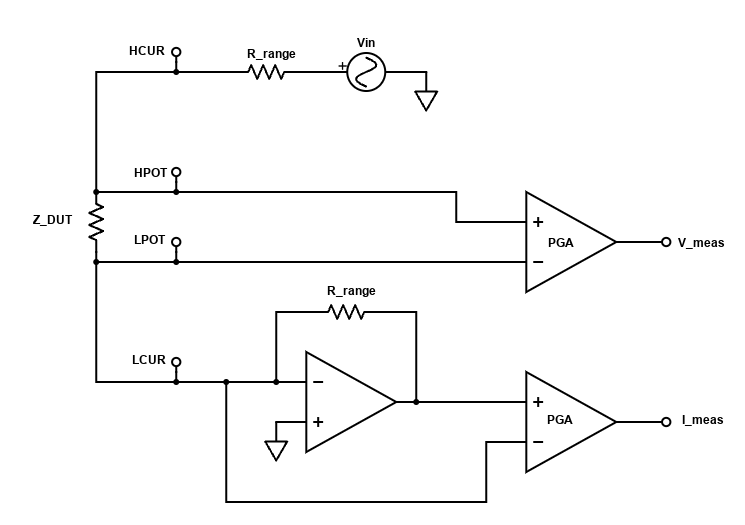

# Table of Contents

- [Feature Overview](#feature-overview)
- [Specifications](#specifications)
  - [Frequency Range](#frequency-range)
  - [Autoranging](#autoranging)
  - [Component Ranges](#component-ranges)
  - [Display Parameters](#display-parameters)
  - [Automatic Parameter Selection](#automatic-parameter-selection)
- [Operational Principle](#operational-principle)
  - [Simplified Schematic](#simplified-schematic)
  - [Voltage and Current Phasor Measurement](#voltage-and-current-phasor-measurement)
- [To be placed later](#to-be-placed-later)

# Feature Overview
* Accurate inductance, capacitance, and resistance measurements @ from 100Hz to 75kHz
* Automatic display of relevant component parameters, or ability to manually select 2 displayed parameters
* Support for frequency sweep plots
* Touchscreen and physical button interface
* Open and short probe calibration

# Specifications

## Frequency Range
* 100Hz - 75kHz in increments of 100Hz

## Autoranging
* TIA Gains: 100Ω, 1kΩ, 10kΩ, and 100kΩ
* ADC Input Amps: 1x, 5x, 25x, 100x

## Component Ranges

Parameter | Range
--- | ---
L  | 1uH to 100H
C  | 1pF to 10mF
R  | 1mΩ to 1MΩ

(actual ranges to be confirmed)

## Display Parameters
Parameter | Description
--- | ---
Rs  | Series resistance (ESR/ESL)
Rp  | Parallel resistance
Cs  | Series capacitance
Cp  | Parallel capacitance
Ls  | Series inductance
Lp  | Parallel inductance
Xs  | Series reactance
Q   | Quality factor
D   | Dissipation factor
\|Z\| | Impedance magnitude
∠Z | Impedance angle

## Automatic Parameter Selection

# Operational Principle

This LCR meter uses an auto-balancing bridge design. The general operation of these are as follows:
1. Connect a sinusoidal input voltage to one side of the DUT and the other side to a virtual ground node
2. Read out the voltage across the DUT using a kelvin-connected differential amplifier
3. Convert the current through the DUT into a voltage using a transimpedance amplifier (TIA). Read this out via a differential amplifier
4. Read the voltage and current measurements in via ADCs
5. Calculate the DUT impedance via phasor arithmetic

## Simplified Schematic

At the top of the circuit, an input signal Vin is generated using a buffered and filtered DAC output. This connects to a resistor $R_{range}$ and then the HCUR terminal. The purpose of the $R_{range}$ resistor will be discussed later.

Moving to the bottom of the circuit, the amplifer works to keep the negating amplifer input at ground. This results in a current of $$I_{DUT}(s) = \frac{V_{in}}{Z_{DUT}(s) + R_{range}}$$ flowing through the DUT. This same current will flow through the bottom $R_{range}$ resistor, resulting in an amplifier output of 
$$I_{meas}(s)=-I_{DUT}(s)\cdot R_{range} = \frac{-V_{in}\cdot R_{range}}{Z_{DUT}(s) + R_{range}}$$

In the middle of the circuit, the voltage across the DUT is read out with kelvin connect lines to remove as much parasitic resistance and inductance from the probe leads. The voltage across the DUT will be 
$$V_{meas}(s)=I_{DUT}(s)\cdot Z_{DUT}(s)= \frac{V_{in}\cdot Z_{DUT}(s)}{Z_{DUT}(s) + R_{range}}$$

From these two measurements, we can derive $Z_{DUT}(s)$ as
$$ Z_{DUT}(s)=\frac{V_{meas}(s)\cdot R_{range}}{I_{meas}(s)}$$

A couple circuit nuances:
* There are 4 $R_{range}$ resistors, 100Ω, 1kΩ, 10kΩ, and 100kΩ. SNR is highest when $R_{range}$ is close to $|Z_{DUT}(s)|$, so the system automatically switches $R_{range}$ via analog muxes based on measurements. I would recommend reed relays for future derivative projects though.
* For large capacitive DUTs, if the top $R_{range}$ resistor was not present the TIA would be unstable due to the creation of a low frequency pole in the feedback loop. The top resistor introduces a zero at half the frequency of this pole, allowing the loop to be stabilized. While there are other methods to achieve stability with a capacitive load, the introduction of the top $R_{range}$ is particularly useful since it allows stability across a wide range of unknown DUTs and it's accuracy does not actually influence the final calculations.
* While potentially not immediately apparent, it is critical that the current readout is fully differential. At high frequencies the loop gain of the TIA is significantly reduced, resulting in a significant sinusoidal voltage on the virtual ground. So long as the measurements are performed differentially, this effect does not influence the calculations.

Further analysis of this design can be found in this TI reference design: https://www.ti.com/lit/ug/tidueu6b/tidueu6b.pdf

## Voltage and Current Phasor Measurement
https://www.desmos.com/calculator/hkwapyh1lp

# To be placed later:

* Many thanks to the work of WeTec/wschuma. Much of the audio codec design and firmware was based on their work on EEVblog and Github
https://www.eevblog.com/forum/projects/teensylcr-a-teensy-based-diy-lcr-meter/
https://github.com/wschuma/TeensyLCR

* In order to maximize SNR, the system will automatically switch between 4 transimpedance amplifier gains. These gains are 100Ω, 1kΩ, 10kΩ, and 100kΩ. For derivative projects, I would recommend switching to reed relays instead of analog muxes. At high frequenies on the 100kΩ range, the input signal is heavily attenuated